<picture>
  <source media="(max-width: 600px)" srcset="./assets/hero-mobile.svg">
  
</picture>

<picture>
  <source media="(max-width: 600px)" srcset="./assets/about-mobile.svg">
  
</picture>

<picture>
  <source media="(max-width: 600px)" srcset="./assets/stack-mobile.svg">
  
</picture>

<picture>
  <source media="(max-width: 600px)" srcset="./assets/work-mobile.svg">
  
</picture>

[Explore The Favourite ↗](https://thefavourite.in) · [Browse my repositories ↗](https://github.com/vermamayank1820-cyber?tab=repositories)

<picture>
  <source media="(max-width: 600px)" srcset="./assets/connect-mobile.svg">
  
</picture>

**[Website](https://thefavourite.in) · [Instagram](https://www.instagram.com/favourite.engineer/) · [Email](mailto:business.thefavourite@gmail.com) · [GitHub](https://github.com/vermamayank1820-cyber)**

About me & toolkit — text version

### Hi, I'm Mayank Verma

I work with data, build useful things with AI, and share what I learn along the way. From dashboards and automation to content and products, I enjoy making complex ideas simple enough to use.

- **Data & insight:** SQL, Power BI, Tableau, Excel, SAS, Alteryx.
- **AI & automation:** Python, LangChain, FAISS, RAG, AI agents, workflows.
- **Build & ship:** FastAPI, React, Next.js, MongoDB, Git, APIs.
- **The Favourite:** AI tools, practical prompts, and ideas worth sharing at [thefavourite.in](https://thefavourite.in).
- **Cloona:** exploring AI content workflows for creators. Work in progress.
- **Code & experiments:** [browse my public repositories](https://github.com/vermamayank1820-cyber?tab=repositories).

Based in India. Curious by default. Always trying.

